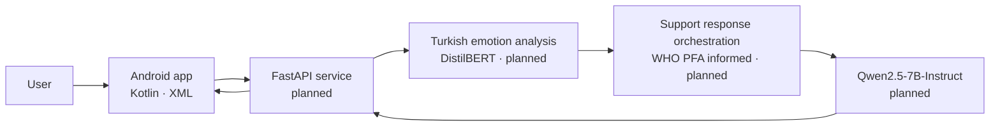

# KGRA / REFAKAT — Research Showcase

KGRA (REFAKAT) is a TÜBİTAK 2209-A research project exploring an AI-assisted mobile experience for women's safety and psychological first-aid support.

> This repository is a public project showcase. The application source code and research materials remain private during the TÜBİTAK project process. This README describes the prototype and its intended architecture; it does not distribute the private implementation, model weights, datasets, or API credentials.

## Project goals

- Provide a clear, accessible Android interface for safety-oriented support flows.
- Explore Turkish emotion analysis as a signal for adapting supportive responses.
- Investigate a conversational support pipeline informed by WHO Psychological First Aid guidance.
- Keep users in control and make the limitations of automated assistance clear.

## Prototype status

The current Android prototype contains the mobile UI flow, including home, chat, emergency, and settings screens. Chat screens are currently interface prototypes; the FastAPI inference pipeline described below is a planned research architecture and is not represented as an integrated production service.

## Proposed architecture

The research plan includes evaluating a Turkish emotion classifier such as `distilbert-base-turkish-emotion-analysis`, and a response model based on `Qwen2.5-7B-Instruct`. A synthetic supervised fine-tuning dataset informed by WHO Psychological First Aid materials is part of the proposed research. These components are research directions, not claims of clinical validation or deployed service capability.

## Technology areas

- **Mobile prototype:** Kotlin, Android Studio, XML, ViewBinding
- **Planned inference service:** Python, FastAPI, Uvicorn
- **Planned NLP research:** Hugging Face Transformers, Turkish emotion analysis, Qwen2.5

## Screenshots

Screenshots are not included in this showcase yet. They will be added after project-approved captures are prepared.

## Research and safety note

This project is an academic prototype and is not a substitute for emergency services, professional mental health care, or qualified safety support. AI generated responses can be incorrect. The project is not clinically validated.

## Acknowledgements

Developed as part of a TÜBİTAK 2209-A project. For questions about the public showcase, contact [Osman Sincar](mailto:osmansincar6866@gmail.com).
